# FinSight Architecture and Workflow

## 1. System Architecture

FinSight is a React 19 and TypeScript application built with Vite. FastAPI in
`src/api.py` is the canonical backend and serves the built frontend. The
production wrapper `src/sarvam_app.py` mounts that app and adds the optional
Sarvam route. The backend runs the V3 recurring-payment detector and connects
to optional Neo4j Aura, hosted PostgreSQL, local SQLite, and Sarvam AI services.

### High-level system diagram

This diagram separates the browser, backend, and data layers and shows the
primary code-level connections.

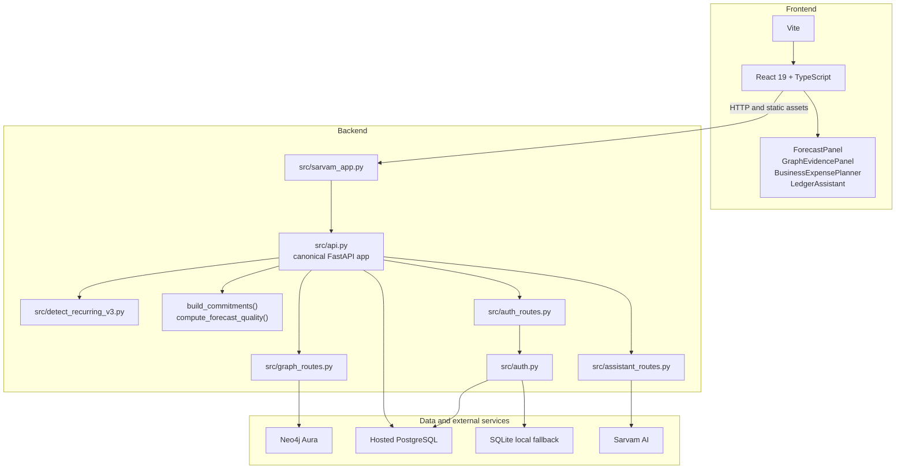

### CSV-to-result data flow

The browser previews a CSV, sends mapped rows to the private endpoint, and
receives derived transactions, commitments, alerts, and forecasts. Graph
ingestion is started separately from the response path.

```mermaid
graph LR
  CSV[CSV statement] --> Preview[POST /api/private-statement<br/>preview]
  Preview --> Map["parse_statement()<br/>map_statement()"]
  Map --> Detect[detect()<br/>V3 detector]
  Detect --> Build[build_commitments()<br/>compute_forecast_quality()]
  Build --> Result[Analysis response]
  Result --> Browser[React frontend]
  Build --> Thread[Background ingest_analysis()]
  Thread --> Aura[(Neo4j Aura)]
  Hosted[POST /api/hosted-statement] --> HostedRuntime[HostedRuntime.statement_action()]
  HostedRuntime --> PG[(PostgreSQL hosted_statements)]
  Auth[Auth routes] --> Users[(finsight_users)]
```

### Database architecture

PostgreSQL stores hosted encrypted statements, hosted sessions, and
`finsight_users`. Neo4j stores the traversable evidence graph. The graph
service also keeps a process-memory fallback for local/demo operation when Aura
is not configured.

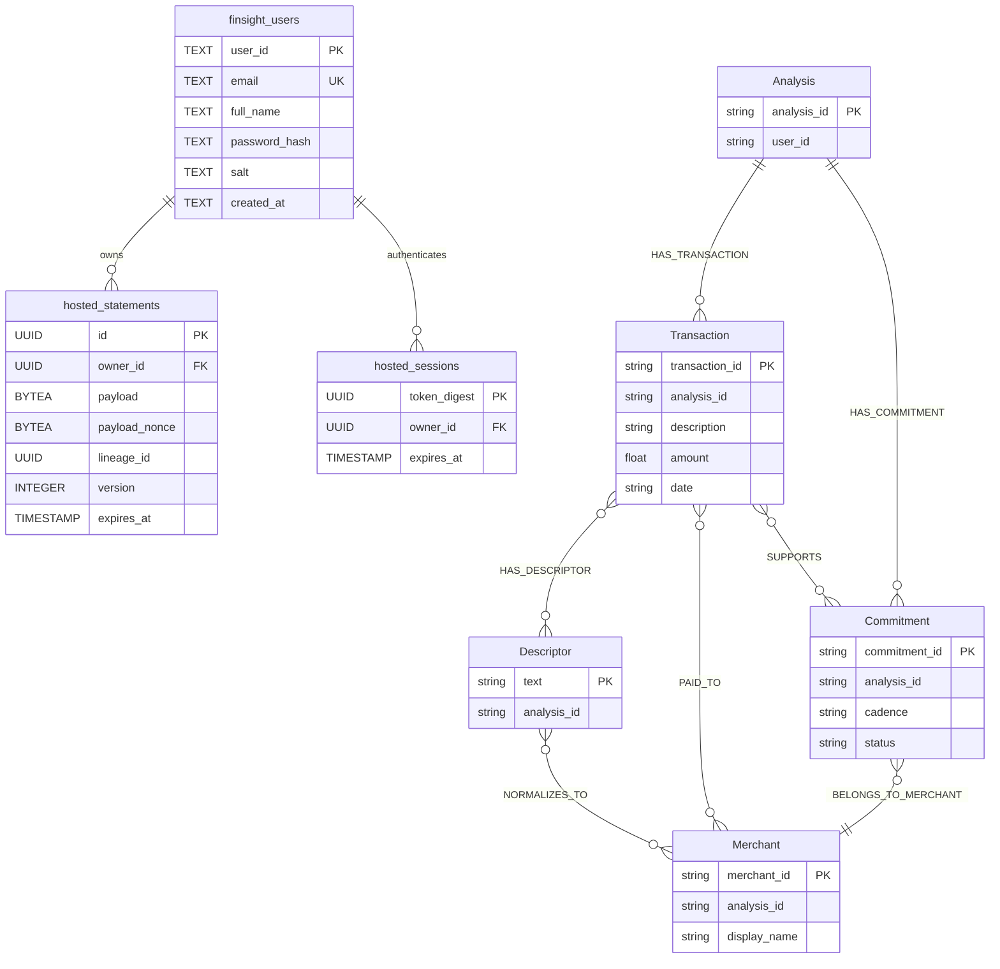

### Deployment architecture

The Dockerfile builds the frontend in Node 26, copies `frontend/dist` into a
Python 3.12 image, and runs one Uvicorn process on Render. Neo4j Aura and
Render PostgreSQL remain external managed services.

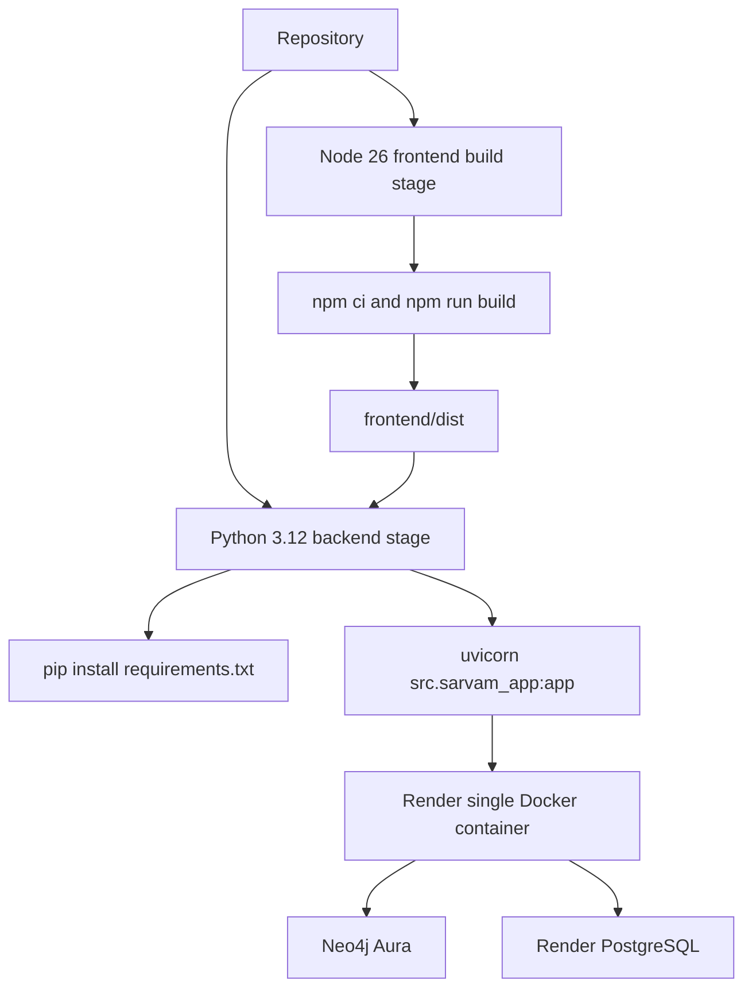

### Private-data boundary

The original CSV stays in the browser for private analysis. The private API
receives it for parsing and derivation, while optional graph ingestion receives
structured analysis evidence. Sarvam receives only an allowlisted summary after
explicit consent. Hosted persistence is a separate authenticated workflow.

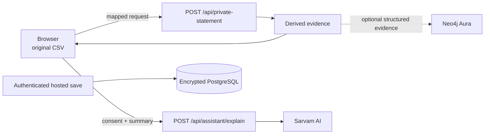

### Component dependency matrix

| Dependency | If unavailable | Recovery |
|---|---|---|
| Neo4j Aura | Graph lookup may use memory/demo evidence or return 503 | Restore `NEO4J_*` settings and re-ingest |
| Hosted PostgreSQL | Hosted readiness/session/snapshot operations fail; auth can fall back to SQLite | Restore database connectivity and restart |
| Local SQLite | Local auth or optional local workspaces become unavailable | Use a writable `FINSIGHT_DATA_DIR`/`FINSIGHT_LOCAL_DB` |
| Sarvam AI | Assistant returns unavailable; local evidence remains | Configure `SARVAM_API_KEY` or use rule-based answers |

### Scalability notes

The single container keeps the browser API, detector, static files, and
optional integrations in one release boundary. A microservice deployment would
separate the frontend/CDN, detector worker, graph-ingestion worker, auth API,
and hosted-storage API behind durable queues, shared observability, and explicit
analysis ownership. The browser-first private CSV boundary should remain.

### Environment variables

| Name | Purpose | Required | Default |
|---|---|---:|---|
| `FINSIGHT_DEPLOYMENT_MODE` | Local/private/hosted behaviour | Optional | `local` in routes; Docker `private` |
| `FINSIGHT_FRONTEND_DIST` | Static frontend directory | Optional | `frontend/dist` |
| `FINSIGHT_PROCESSED_DIR` | Detector outputs | Optional | `data/processed` |
| `CORS_ALLOWED_ORIGINS` | Allowed browser origins | Optional | Localhost origins |
| `FINSIGHT_HOSTED_DATABASE_URL` | Hosted SQLAlchemy PostgreSQL URL | Hosted | Empty |
| `FINSIGHT_HOSTED_ENCRYPTION_KEY` | Hosted AES-GCM key | Hosted | None |
| `FINSIGHT_HOSTED_FALLBACK_KEYS` | Previous encryption keys | Optional | `[]` |
| `FINSIGHT_HOSTED_ORIGIN` | Exact HTTPS origin | Hosted | None |
| `FINSIGHT_HOSTED_CREDENTIALS` | Operator credential map | Hosted | None |
| `FINSIGHT_DATA_DIR` | Local auth data and secret directory | Optional | `/tmp/finsight_data` on POSIX; repository `data` on Windows |
| `FINSIGHT_LOCAL_DB` | Optional local workspace path | Optional | Disabled |
| `FINSIGHT_AUTH_SECRET` | HMAC token secret | Optional | Persisted `.auth_secret` fallback |
| `NEO4J_URI` | Aura URI | Optional | Empty |
| `NEO4J_USERNAME` / `NEO4J_USER` | Aura user | Optional | `neo4j` |
| `NEO4J_PASSWORD` | Aura password | Optional | Empty |
| `NEO4J_SECURE_SCHEME` | Aura scheme conversion | Optional | `neo4j+s://` |
| `SARVAM_API_KEY` | Server-side Sarvam key | Optional | Empty |
| `SARVAM_MODEL` | Sarvam model | Optional | `sarvam-105b-conversations` |
| `VITE_API_URL` | Frontend API base | Optional | `/` in Docker |
| `VITE_FINSIGHT_HOSTED` | Hosted frontend mode | Optional | `false` |

## 2. Workflow

### Primary consumer workflow

This is the main import path from CSV preview through V3 detection, forecast
quality, asynchronous graph ingestion, and frontend rendering.

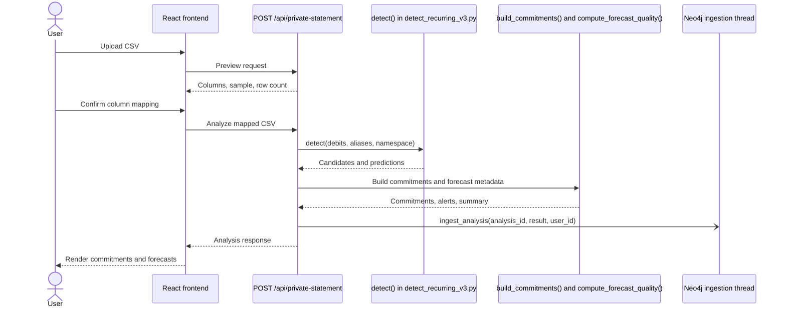

### Neo4j evidence workflow

`GraphEvidencePanel.tsx` calls the graph route for a selected commitment. The
route can pass an authenticated user ID into the graph query for owner-scoped
matching.

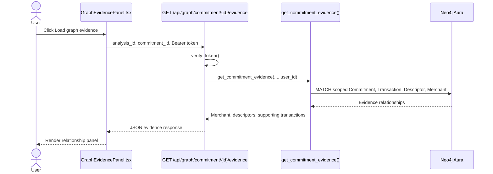

### Freelancer classification workflow

Backend labels currently live in `_classifications` for the process lifetime.
The frontend planner also maintains a local selection and calculates a forecast
from the loaded commitments. `/api/summary/business` sums classified
`typical_amount` values when labels were submitted through the backend route.

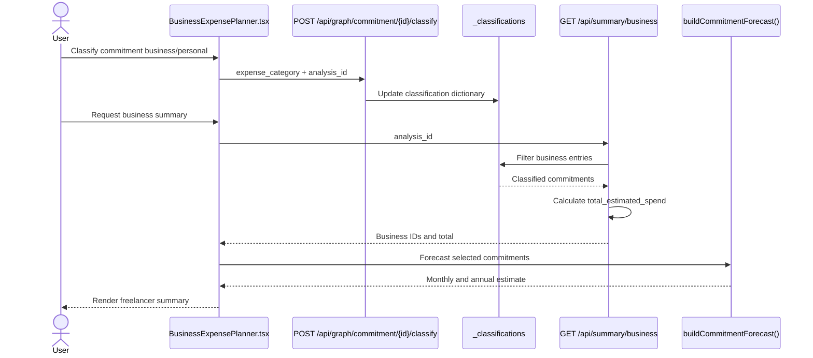

### User authentication workflow

`src/auth.py` hashes passwords with PBKDF2-HMAC-SHA256 and stores users in
`finsight_users` through SQLAlchemy. Hosted PostgreSQL is preferred; local
SQLite is the startup fallback. Tokens are HMAC-SHA256 signed and expiring.

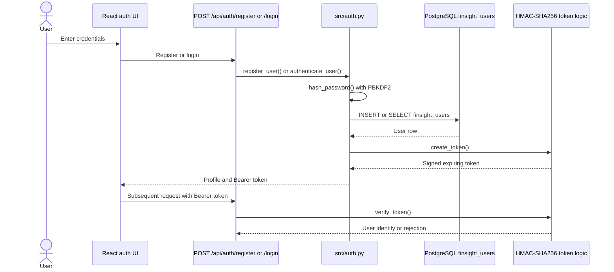

### Error handling flow

Validation errors stop before detector execution. Optional providers degrade to
local evidence, while hosted readiness failures remain explicit service errors.

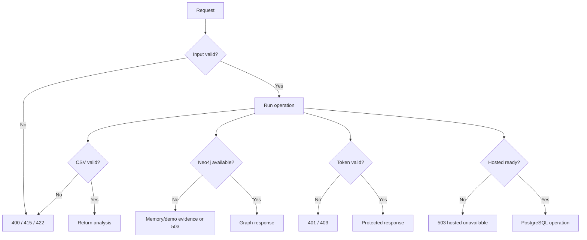

### Private-data workflow

The private endpoint does not persist the original CSV. It returns derived
results and may send structured evidence to Neo4j. An explicit hosted save is a
separate authenticated operation.

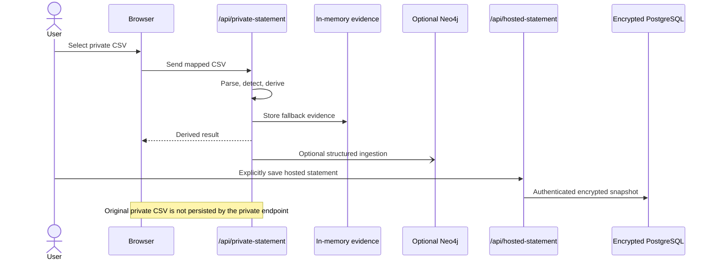

### Forecast staleness workflow

`compute_forecast_quality()` combines observation count, last-observed age,
observed span, and cadence reliability into warning metadata consumed by the
forecast UI.

```mermaid
graph LR
  Tx[Transactions] --> Build[build_commitments()]
  Build --> Quality[compute_forecast_quality()]
  Quality --> Count[observation_count]
  Quality --> Age[last_observed_days_ago]
  Quality --> Span[statement_days_covered]
  Quality --> Cadence[cadence_estimate_reliable]
  Count --> Warn{Sparse, stale, or irregular?}
  Age --> Warn
  Span --> Warn
  Cadence --> Warn
  Warn -- Yes --> Caveat[Limited evidence warning]
  Warn -- No --> Estimate[Forecast estimate]
  Caveat --> Panel[ForecastPanel.tsx]
  Estimate --> Panel
```

### CSV preview and analysis workflow

The first request omits `mapping` and returns a bounded preview. The second
request maps semantic columns and only then invokes the detector.

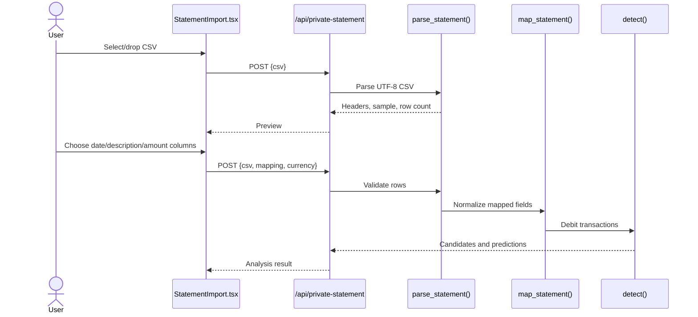

## Key Design Decisions

### Neo4j alongside PostgreSQL

PostgreSQL is appropriate for transactional users, sessions, and encrypted
hosted snapshots. Neo4j complements it by making evidence traversals from
analysis to transactions, descriptors, merchants, and commitments explicit.

### Single Docker container

The MVP has one tightly coupled static frontend, FastAPI API, detector, and
provider boundary. A two-stage image is simple to release on Render. A future
microservice split would need durable queues, a detector worker, graph worker,
centralized secrets, and explicit ownership/observability contracts.

### CSV instead of a bank API

CSV avoids collecting banking credentials and avoids claiming live bank
connectivity. Browser preview and mapping give users control over the rows sent
for analysis and keep the detector evidence explainable.

### PBKDF2 over bcrypt

PBKDF2-HMAC-SHA256 uses the Python standard library, a random salt, and an
explicit work factor without adding a native password-hashing dependency. A
future migration should use a versioned hash format and rehash policy.

## Failure Modes

| Component | Failure mode | System behaviour | Recovery path |
|---|---|---|---|
| CSV parser | Bad encoding, columns, dates, or amounts | Clear 400/415/422 validation response | Correct mapping or upload valid UTF-8 CSV |
| V3 detector | Sparse or irregular history | Low-confidence/no candidate and evidence caveats | Import a longer history and review transactions |
| Neo4j Aura | Missing URI, bad credentials, or query failure | Memory/demo evidence or 503 graph response | Restore `NEO4J_*` settings and re-ingest |
| PostgreSQL | Hosted DB unavailable or schema missing | Hosted readiness/session operations fail; auth falls back to SQLite | Restore DB connectivity/schema and restart |
| SQLite | Local data directory cannot be opened | Auth initialization is swallowed; local workspaces report unavailable | Set writable `FINSIGHT_DATA_DIR`/`FINSIGHT_LOCAL_DB` |
| Auth token | Missing, expired, or invalid HMAC | 401/403 protected-route response | Log in again |
| Sarvam AI | Missing key, timeout, or provider error | 503/consent rejection; local evidence remains | Configure `SARVAM_API_KEY` or use local assistant |
| Hosted session | Expired or revoked session | Request rejected before snapshot access | Re-authenticate |
| Render | Build or startup failure | Health check fails; deployment is not ready | Inspect build logs, variables, `/api/ready`, and Uvicorn entry point |
