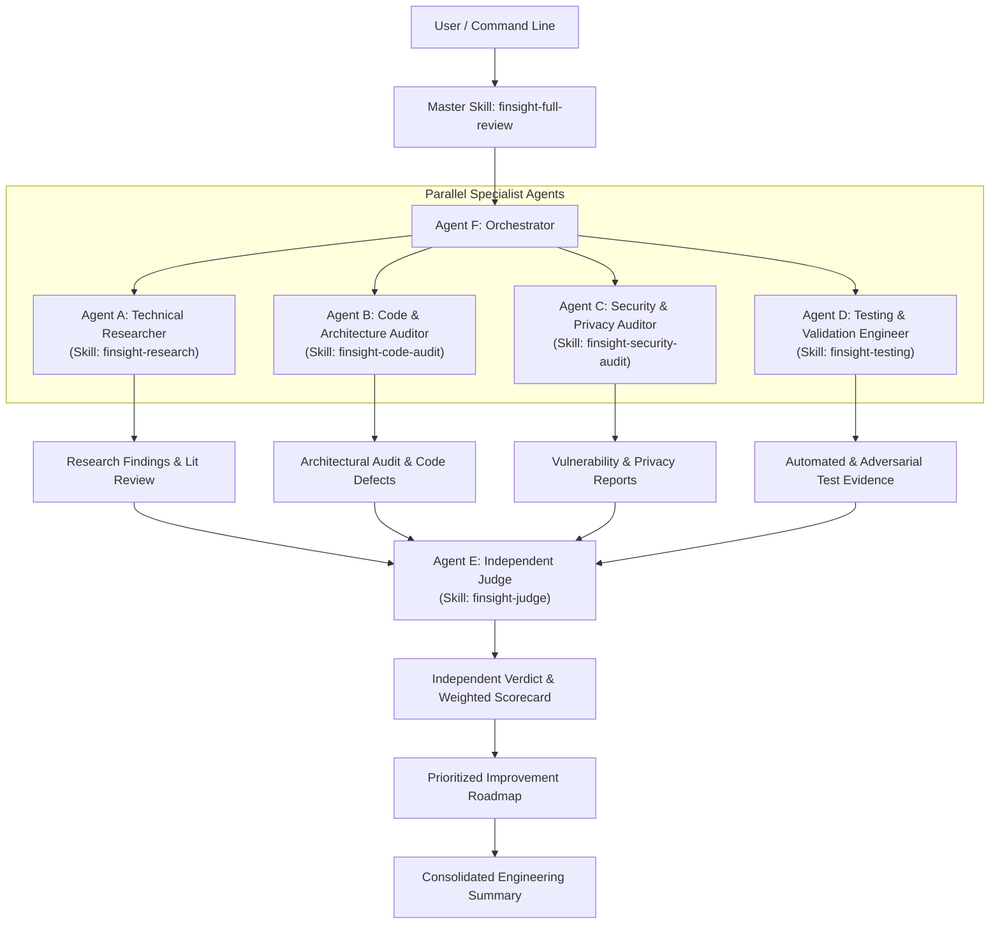

# FinSight Multi-Agent Architecture & Orchestration Specification

**System**: FinSight Autonomous Multi-Agent Engineering Intelligence System  
**Lead Architect**: Orchestrator (Agent F)  
**Version**: 1.0.0  
**Configuration Path**: `.agents/`  

---

## 1. System Overview & Multi-Agent Architecture

The FinSight Evaluation Architecture coordinates specialized autonomous agent roles working in structured, decoupled roles. The orchestration engine enforces separation of concerns, independent adversarial skepticism, and reproducible verification.

---

## 2. Agent Roster & Responsibility Matrix

### Agent A: Technical Researcher (`technical-researcher`)
- **Domain**: Algorithmic state of the art, entity resolution, financial regulations.
- **Skill**: `finsight-research`
- **Inputs**: Academic papers, regulatory guidelines (RBI/NPCI), industry standards.
- **Deliverable**: `docs/engineering-evaluation/research-report.md`
- **Output Standard**: Verifiable citations with year, regulatory circular IDs, and clear trade-off analyses. No simulated references.

### Agent B: Architecture and Code Auditor (`code-auditor`)
- **Domain**: Software engineering hygiene, modularity, coupling, maintainability, scalability.
- **Skill**: `finsight-code-audit`
- **Inputs**: Full repository source code (`src/`, `config/`, `frontend/src/`).
- **Deliverable**: `docs/engineering-evaluation/architecture-audit.md`
- **Output Standard**: Exact file paths, line references, confirmed defects separated from stylistic concerns.

### Agent C: Security and Privacy Auditor (`security-auditor`)
- **Domain**: OWASP Top 10, data leak prevention, authorization, injection vectors, supply chain security.
- **Skill**: `finsight-security-audit`
- **Inputs**: Backend FastAPI routes, dependencies (`requirements.txt`, `package.json`), network calls.
- **Deliverable**: `docs/engineering-evaluation/security-audit.md`
- **Output Standard**: CVSS-aligned severity ratings, non-destructive verification, clear proof of concept, remediation code snippets.

### Agent D: Testing and Validation Engineer (`testing-engineer`)
- **Domain**: Test execution, test reproduction, boundary & negative testing, adversarial dataset synthesis.
- **Skill**: `finsight-testing`
- **Inputs**: `tests/`, `src/evaluate_detector_v3.py`, synthetic datasets.
- **Deliverable**: `docs/engineering-evaluation/test-report.md`
- **Output Standard**: Executed CLI commands, raw logs, pass/fail matrices, adversarial stress results.

### Agent E: Independent Judge (`independent-judge`)
- **Domain**: Critical cross-examination, falsification testing, unbiased evaluation, weighted scoring.
- **Skill**: `finsight-judge`
- **Inputs**: Deliverables from Agents A, B, C, D and raw verification logs.
- **Deliverable**: `docs/engineering-evaluation/judge-verdict.md`
- **Output Standard**: Weighted scorecard (25% Detection, 20% Architecture, 20% Security, 20% Testing, 15% Research). Hard approval blockers applied. Authority to reject findings lacking verifiable evidence.

### Agent F: Multi-Agent Orchestrator (`orchestrator`)
- **Domain**: Task decomposition, dependency management, execution coordination, final report synthesis.
- **Skill**: `finsight-full-review`
- **Deliverable**: `docs/engineering-evaluation/execution-summary.md` and `docs/engineering-evaluation/improvement-roadmap.md`

---

## 3. Execution & Delegation Model

Antigravity executes subagents via native `invoke_subagent` and `manage_subagents` primitives. When subagents run in isolated sandboxes:
1. **Parallel Execution**: Where multi-threading or parallel agent workers are enabled, Specialists A through D execute concurrently.
2. **Sequential Fallback Disclosure**: If subagent spawning is constrained by environment sandbox policies, the orchestrator executes each specialist in separate, bounded phases, preserving context isolation and logging the sequential nature without fabrication.
3. **Immutability of Judge Verdict**: The Orchestrator is strictly prohibited from altering the Judge's score or overriding identified blockers.

