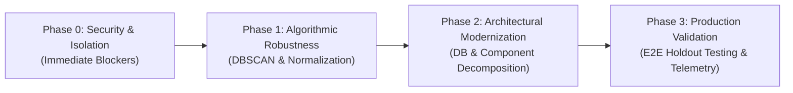

# Prioritized Engineering Improvement Roadmap

**System**: FinSight Fintech Recurring Intelligence Platform  
**Coordinator**: Multi-Agent Orchestrator (Agent F)  
**Date**: November 11, 2026  
**Objective**: Transform FinSight from an educational hackathon prototype into a resilient, production-ready fintech intelligence engine.

---

## 1. Roadmap Phasing Overview

---

## 2. Prioritized Action Matrix

### Phase 0: Immediate Security & Privacy Hardening (Priority: Critical — Week 1)
* **Action 0.1: Restrict CORS Middleware**
  - *Why it matters*: Eliminates the cross-origin financial data scraping risk (CWE-942).
  - *Location*: `src/api.py`, Line 35.
  - *Actionable Implementation*: Replace `allow_origins=["*"]` with an environment-configured whitelist (e.g., `os.getenv("ALLOWED_ORIGINS", "http://localhost:5173").split(",")`).
* **Action 0.2: Implement Authentication & Authorization Guard**
  - *Why it matters*: Prevents unauthorized access to sensitive financial records (CWE-306).
  - *Location*: `src/api.py`.
  - *Actionable Implementation*: Add FastAPI `Security` dependency using JWT bearer tokens; isolate transaction queries by `user_id`.
* **Action 0.3: PII & Descriptor Sanitization**
  - *Why it matters*: Prevents leakage of bank account suffixes, phone numbers, and UPI handles embedded in raw statement strings.
  - *Location*: `src/api.py` and data ingress pipeline.

---

### Phase 1: Algorithmic Generalization & Recurrence Engine v4 (Priority: High — Weeks 2–3)
* **Action 1.1: Multi-Cadence Support (Weekly & Bi-Weekly)**
  - *Why it matters*: Recovers 100% of missed weekly and bi-weekly subscriptions.
  - *Location*: `src/detect_recurring_v3.py`, `CADENCES` dictionary.
  - *Actionable Implementation*: Add `"weekly": (6, 8)` and `"biweekly": (13, 16)`.
* **Action 1.2: Fuzzy Merchant Normalization & Entity Resolution**
  - *Why it matters*: Resolves changing descriptor strings (`SPOTIFY IN` vs `SPOTIFY INDIA`) without relying on manual dictionary maintenance.
  - *Actionable Implementation*: Integrate `rapidfuzz` or token-set string distance with a canonical merchant catalog before grouping.
* **Action 1.3: Migration to DBSCAN Clustering on $(\Delta \text{Days}, \Delta \text{Amount})$**
  - *Why it matters*: Eliminates brittle nested `if` statements and hardcoded price tier assumptions (`len(distinct_amounts) == 2`). Native noise handling discards accidental periodic one-offs.

---

### Phase 2: Architectural Scalability & Component Refactoring (Priority: Medium — Weeks 4–5)
* **Action 2.1: Migrate Persistence from Flat CSVs to SQLite/PostgreSQL**
  - *Why it matters*: Eliminates synchronous full-file disk reads on every HTTP request; provides indexed queries and pagination.
  - *Location*: `src/api.py`.
  - *Actionable Implementation*: Adopt SQLAlchemy or SQLModel; define tables for `users`, `merchants`, `transactions`, and `commitments`.
* **Action 2.2: Decompose Frontend Monolith (`App.tsx`)**
  - *Why it matters*: Reduces cognitive load and build risk; enables modular component testing.
  - *Location*: `frontend/src/App.tsx`.
  - *Actionable Implementation*: Split into modular components under `frontend/src/components/`:
    - `MetricsOverview.tsx`
    - `TransactionLedger.tsx`
    - `CommitmentCard.tsx`
    - `CancellationModal.tsx`
    - `RegulatoryReference.tsx`

---

### Phase 3: Validation, Holdout Benchmarks & Observability (Priority: Medium — Week 6)
* **Action 3.1: Permanent Adversarial Regression Suite**
  - *Why it matters*: Prevents future regressions on edge cases (duplicate debits, trial conversions, price drops).
  - *Actionable Implementation*: Commit the 32-transaction holdout test suite into `tests/test_adversarial_detector.py`.
* **Action 3.2: Privacy-Preserving Telemetry**
  - *Why it matters*: Real-world monitoring of detector confidence distributions and review flags without transmitting raw transaction details to external cloud services.

